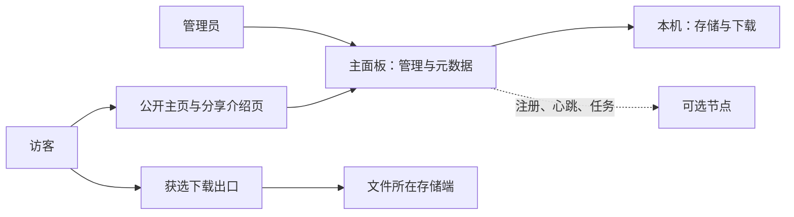

# 架构与数据设计

**状态：初步技术草案，尚未实现。** Go 单文件、SQLite 和本地文件系统来自原聊天的技术倾向；具体库、协议版本和前端构建工具尚未选定。本文补充可开发的边界规则，新增建议的性质见[来源与设计决策](06-来源与设计决策.md)。

## 1. 组件边界

主面板承载管理 API、公开主页、资源介绍页、元数据、任务协调及本机存储与下载服务。前端静态资源随主程序分发，运行时不要求 Node.js；构建时是否使用前端工具链另行决定。

可选节点运行轻量组件，负责被授权的存储、传输、下载与本地用量保护。节点不承担公开管理后台，也不复制主面板数据库；保存必要的本机凭据、任务状态和持久化用量。界面中的“本机节点”复用相同业务契约，但不必通过公网调用自己。

图中的出口与存储端可以是同一台机器。虚线是控制流，文件传输是单独的数据流；控制连接不能自动作为穿透 NAT 的数据通道。

## 2. 控制流与数据流

| 场景 | 控制行为 | 数据路径草案 |
| --- | --- | --- |
| 本机上传 | 管理员创建上传任务，面板检查空间 | 浏览器 → 本机临时文件 → 校验落盘 |
| 远端上传 | 面板授权目标存储，创建任务 | 基线为浏览器 → 面板 → 远端存储，流式转发 |
| 本机直出 | 面板签发本机下载凭证 | 本机磁盘 → 访客 |
| 远端直出 | 面板签发节点限定凭证 | 远端磁盘 → 访客 |
| 跨节点下载 | 面板选择出口与源存储 | 源存储 → 出口 → 访客 |
| 移动文件 | 面板创建可恢复任务并协调位置切换 | 源存储 → 目标存储；不可直达时明确走面板中转 |

远端上传优先流式转发以降低浏览器跨域和凭证复杂度，其代价是面板也产生收发流量。直接向节点上传属于后续优化候选，不能在首版界面暗示上传一定绕过面板。禁止整文件读入内存；中转取消后应及时取消上游读取。

Storage 关闭意味着不能再接收新文件，不意味着现有文件可直接丢弃。Relay 关闭意味着不参与访客出口选择，仍可向获授权的其他出口供给已有文件。停用或移除含文件的节点前，必须显示受影响文件并要求先迁移，或明确保留离线记录。

## 3. 逻辑数据模型

下表定义业务对象，暂不固定 SQL 字段类型与迁移版本。标识符与存储键使用内部生成值，用户文件名、分享别名和 IP 都不能直接作为磁盘定位依据。

| 对象 | 关键字段建议 | 约束 |
| --- | --- | --- |
| 管理员 | ID、用户名、密码哈希、凭证版本 | 单管理员；不保存明文密码 |
| 节点 | ID、是否本机、IP、端口、控制地址、公开下载地址、能力、状态 | ID 稳定；IP 用于显示；连接凭据单独保护 |
| 节点地区 | 自动国家/城市、手动值、来源标记 | 手动值优先且不被自动覆盖 |
| 文件 | ID、显示文件名、大小、哈希、状态、主存储位置、版本 | 上传完成前不允许公开 |
| 文件位置 | 文件 ID、节点 ID、内部存储键、完整性状态 | 一个主位置与零个或多个已校验副本；传输目标完整校验后才提交，副本清理不能删除最后的主位置 |
| 分享 | ID、文件 ID、路径别名、启用、主页展示、线路模式、指定出口、授权版本 | 路径唯一；主页展示蕴含分享启用 |
| 资源内容 | 文件 ID、标题、版本、简介、正文、封面与截图引用、按钮文字 | 与实际文件内容分开存储 |
| 下载会话 | ID、文件版本、分享版本、出口、到期时间、状态 | 用于续传、撤销与流量限制，不等于 HTTP 请求数 |
| 用量与策略 | 节点 ID、周期、发送/接收累计、安全线、重置日、时区、策略版本 | 重启保留累计；周期切换不丢历史 |
| 传输任务 | ID、类型、源/目标、阶段、进度、校验、错误 | 可恢复、幂等；失败不能误删源 |
| 个性化 | 配置版本、站点内容、颜色、素材引用 | 与文件数据、账号和节点密钥分离 |

下载统计与配额统计要分开。断点续传与多连接属于一个逻辑下载会话，但每个响应实际发送的字节仍分别进入配额累计。

## 4. 分享授权与断点续传

稳定入口采用 `/s/{slug}`。点击下载时，面板重新检查分享状态、文件可读性、候选链路与用量策略，再签发限定文件版本、出口、会话、权限与到期时间的凭证。`/d/{file_id}` 是拟定的受控下载入口，不能通过猜测存储路径绕开授权。

建议下载链接的初次有效期为 5 分钟，这是可调整默认值。凭证有效期控制新请求的授权，不应在一次已授权响应传输到第 5 分钟时直接截断大文件；持续传输仍受用量、来源并发和撤销策略检查。

过期后的 Range 新请求必须拒绝旧凭证。介绍页可重新获取同一文件版本的授权，再携带原偏移续传；浏览器管理的下载器不一定支持自动替换 URL，界面需要提供重新获取地址的恢复方式，不能承诺所有外部下载器无感续传。

实现需正确处理 `206`、`Content-Range`、`416`、`HEAD`、`ETag` 与 `If-Range`，文件内容变化时不允许把不同版本拼接。第一版可只支持单段 Range；多段 Range 不支持时返回明确结果，必须纳入协议验收。上游读取也须传递范围，不能为一个尾部 Range 拉取整个源文件。

关闭分享、删除文件或修改敏感授权配置时增加授权版本。建议节点使用短期可续租的会话授权与撤销通知；无法确认撤销或租约过期时停止服务，具体最大撤销延迟待协议设计时确定，不能把旧凭证写成无条件永久有效。签名只能减少底层地址长期复用，公开分享仍可能被重复申请下载，必须结合限流和配额。

## 5. 出口选择与回退

自动线路只解析为管理员当前默认出口，不做地理位置、权重或智能测速调度。指定线路尝试指定出口；默认出口或指定出口不可用时，按分享的回退策略检查本机。候选必须具有 Relay 能力、访客可达、到存储端的数据路径可用，并通过链路中每个服务端的用量检查。

只有源文件仍可读取，本机回退才有意义。如果文件唯一副本在离线节点，即使本机在线也不能恢复下载；页面应显示暂时不可用，保留稳定介绍页。正在传输的连接失败后不能直接跨服务器无缝续接，后续 Range 需重新授权并验证文件版本一致。

心跳状态、面板到节点可达性、出口到存储可达性和公网下载可达性分别保存。无法完成外部探测时显示“待验证”，本机检查监听端口不能视作访客已可访问。

### 5.1 主面板失联与卸载后的节点行为

主面板正常停止、卸载或网络中断后，节点按控制连接检测结果进入“主面板离线”状态，不自动卸载程序、不删除正式文件，也不清空本地用量与凭据。节点仅凭失联无法判断面板是临时中断还是永久删除，因此不能触发延时自动删文件等破坏性清理。

进入离线状态后，节点停止接受新的访客下载会话，不能使用缓存凭证开启新会话；新的 Range 请求也不能绕过离线状态继续取数。已开始的响应仅在现有会话租约仍有效、未撤销且本地流量保护允许时继续；无法续租则到期停止。初次下载链接的有效期与活动响应租约分别判断，不能用持续连接绕开租约或本地额度。离线判定时限、租约长度与停止延迟待协议设计确定并纳入验收。

节点保留程序以便有界重试原主面板连接，不因连接失败无限刷日志或放宽授权。原面板以有效身份恢复后，先重新验证凭据、授权状态与策略，再恢复新下载；同一地址上出现全新面板不能仅凭地址相同自动取得信任。

若主面板彻底卸载并丢失数据库、分享配置与节点凭据，原分享入口失效，远端文件仍保留但不能继续由已删除的面板管理。第一版不承诺重装后自动找回节点、文件索引或分享关系；应从一致性备份恢复并验证关联，或由管理员在节点本机处理文件与独立卸载。此规则不新增自动接管或扫描恢复功能。

## 6. 用量保护

每台节点在本地累计 FilePanel 实际接收与发送的字节，面板只汇总展示与下发策略。节点汇报建议采用持久化累计值、周期 ID、实例/序列信息，面板按版本去重，避免心跳重试重复累计或重启清零。统计批次大小和持久化间隔需要在性能与误差间实测确定。

建议默认额度口径为该节点 FilePanel 的应用层发送字节，同时保留接收字节供查看；服务商双向计费的场景需支持发送加接收的策略选项。应用层字节与网卡、TLS、重传及服务商计费口径有差异，界面始终显示“FilePanel 用量”，安全余量不能保证其他程序不会用尽套餐。

同一笔跨节点下载会在存储节点产生发送流量，在出口节点产生接收与发送流量；中转机同样计数。各节点分别保护，总览不可把所有节点之和称为访客净下载量。传输任务、管理下载和公开素材也有实际用量，应记录分类。

建议设置额度后预留 5%，例如 1 TB 按十进制 1000 GB 展示时，公开下载上限为 950 GB。每次授权和响应发送过程都检查可用预算，用字节预算分配控制并发超发；到线时停止新增公开下载，并在有限缓冲范围内停止活动公开传输。只阻止新任务无法阻止已经开始的大文件继续耗尽额度。

管理入口保留可访问，但管理员下载和迁移同样要显示并检查节点预算；不得借管理员身份静默绕过保护。恢复操作由管理员在网页明确调整额度或策略。额度未填写时不虚构套餐上限：异常来源保护仍开启，界面提示“尚未设置月额度，套餐总量保护未生效”。

建议重置周期使用明确配置的时区，默认 UTC，并展示下次重置时刻。重置日 29–31 在短月按当月最后一天处理；历史周期保留，时间回拨不能重复清零。单来源默认并发 3 可作为初始建议，最终阈值需验证共享出口和多线程下载；真实访客 IP 只从已配置的可信代理获取。

## 7. 磁盘与移动一致性

空间保护须适配 1GB 小盘，不再固定至少保留 1GiB；非零安全余量、受控配置和资源验收以根目录 [测试环境与轻量验收](../TEST_ENVIRONMENT.md) 为准，不能为通过测试关闭保护。预留基于文件所在文件系统真实空闲空间，扣除其他在途任务预算；上传过程中继续检查，以应对其他程序写盘和未知长度请求。临时文件、图片、日志与导入均受空间约束。当前代码是否落实须按源码与实测核对，文档更新不等于实现已修复。

移动任务依次经过创建、预检与预留、流式传输、大小与 SHA-256 校验、切换主位置、清理源副本、完成。校验前源位置保持有效；切换与任务阶段在数据库中一致提交，源文件清理失败记录为“目标已切换，源清理待重试”，不能回报整个移动失败后再次破坏数据。

任务以 ID 幂等重试；中断时保留可识别的临时对象，重启后对账。切换后允许已授权读取源文件的传输结束，或按有界租约延迟清理；不能在活动读取期间直接删除所依赖的数据。路径始终使用受控根目录和内部键，拒绝目录穿越与链接逃逸。

## 8. 模块与接口轮廓

建议按身份会话、文件与上传、分享与发布、下载网关、节点、策略与用量、传输任务、个性化、访问诊断、更新维护划分模块。管理接口统一在受保护的管理 API 命名空间下，公开接口只暴露公开内容和受控下载授权，节点接口使用独立认证。

本阶段不固定接口字段、错误码和 URL 版本。开始编码前应为上传完成、获取授权、心跳累计、移动状态和撤销行为建立接口契约；管理写操作校验会话与 CSRF，限制登录尝试，密码采用合适的慢哈希。节点入网票据短期有效且一次使用，入网后换成可撤销的独立凭据；文件内容接口也要验证文件级权限。
