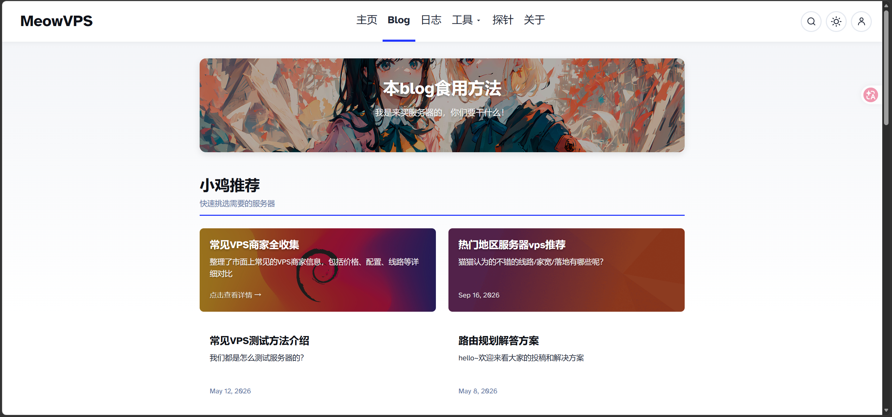

# 页面与视觉规范

**当前视觉依据：用户在 2026-10-15 提供的新截图与 [MeowVPS Blog](https://meowvps.com/blog/)。旧聊天截图已被替换，不再作为设计基准。** 本文件描述设计目标，尚无页面实现或浏览器验收。

## 1. 参考与适配方向



截图用于判断布局、颜色、间距与层次；网页读取用于核对导航、搜索和内容卡片结构。网页文本读取没有验证移动端、交互动画或深色模式，这些是 FilePanel 需要自行设计和验证的能力。图片保存在项目中用于设计对照，不作为应用运行时背景或素材。

| 参考特征 | FilePanel 的应用方式 | 本次设计建议 |
| --- | --- | --- |
| 顶部白色横向导航 | 左侧站点名，中部少量导航，右侧搜索与明暗切换 | 首页只需“资源”；管理员入口可放页脚 |
| 居中且宽度受限的主体 | 内容不铺满超宽屏，给阅读和卡片留白 | 内容最大宽度约 1120 px |
| 圆角大横幅 | 站点标题与一句介绍，支持管理员背景图 | 桌面高度约 210–240 px；无图用纯色或轻渐变 |
| 标题、说明和强调线 | 用“公开资源”组织文件集合 | 首版一个集合，不引入分类体系 |
| 双列宽卡片 | 标题、简介、版本、大小、更新时间 | 桌面两列，手机一列 |
| 白色与浅灰背景 | 背景与内容层次清楚，阴影克制 | 避免大片高饱和底色与密集边框 |
| 蓝紫色强调 | 当前导航、分隔线、按钮和焦点 | 初始色建议 `#4F46FF`，允许个性化修改 |

参考只用于视觉方向，不照搬站点品牌、插画、文章、导航业务和账号功能。本站使用自有站点名称与管理员提供的素材；默认提供可独立使用的简洁背景，不从参考站热链图片。

## 2. 公开主页

公开主页 `/` 无需登录，只呈现管理员主动开启主页展示的资源。结构为顶栏、站点横幅、资源标题与搜索、双列资源卡片、页脚；默认不设置推荐分组、标签分类和侧边栏，避免为了复刻博客而增加内容管理功能。

```text
站点名                         资源        搜索  明暗切换

                  居中内容区
┌───────────────────────────────────────────────────┐
│                   站点标题                        │
│                   一句话介绍                      │
└───────────────────────────────────────────────────┘

公开资源                            搜索资源名称或简介
─────────────────────────────────────────────────────
┌────────────────────────┐ ┌────────────────────────┐
│ 封面或轻量渐变背景     │ │ 封面或轻量渐变背景     │
│ GDPU 小助手            │ │ 示例工具包             │
│ 简介                   │ │ 简介                   │
│ v1.3 · 82.4 MB · 日期  │ │ 1.2 GB · 日期          │
└────────────────────────┘ └────────────────────────┘

站点页脚                                           管理
```

卡片宽高与文字排布借鉴新图的舒展双列布局，不沿用旧图的密集多列网格。没有封面时仍保持完整视觉结构，不能出现破图或强制管理员补图；标题最多展示两行，简介最多三行，完整名称在详情页可见。底部保留版本、大小与更新时间，不引入作者头像、阅读量或评论数。

默认按公开资源更新时间倒序，排序规则属于初版建议。资源较多时采用常规分页，初始每页 20 项；搜索仅覆盖公开资源的标题、简介和文件名。空站点显示“暂时没有公开资源”，搜索无结果显示清除关键词入口，网络失败显示重试；不能把加载失败显示成资源数量为零。

## 3. 下载介绍页

`/s/{slug}` 延续同一顶栏、内容宽度、色彩与页脚。页面包含标题、版本、简介、封面或截图、正文、文件名、大小、更新时间、下载按钮与必要的线路选择。点击资源卡片只进入介绍页，点击下载按钮后才申请凭证并开始下载。

未编辑内容时采用文件名、大小和默认“立即下载”即可发布，不强制填写正文或封面。默认模板兼顾纯文字资源与带截图的软件发布，图片限定最大宽度并延迟加载。正文保存 Markdown，渲染时净化危险内容，不提供任意 HTML、JavaScript 或自定义脚本入口。

只有本机时不展示多节点概念。添加可用出口后可显示“自动、本机、IP · 地区”，实际连接地址仍由授权层决定；公开页面不展示节点控制地址、密钥和磁盘路径。出口异常时先尝试允许的回退路径，无法恢复再显示“文件暂时无法下载，请稍后重试”。

下载按钮需有就绪、申请中、开始下载、临时受限、资源不可用、网络失败等状态。请求中避免重复发起授权，受限时展示可重试时间；临时链接过期时提供重新获取入口。介绍页本身在流量保护触发后仍可打开，但不能宣称所有下载器都会自动续传。

## 4. 管理后台

后台入口统一 `/admin`，未认证显示登录界面。仅保留四个一级入口：文件、用量与状态、使用帮助、设置。设置再按站点外观、访问地址、流量保护、节点与线路、账号安全、更新与维护分区。后台沿用公开页面的颜色、圆角和字体，但按操作效率使用桌面表格、手机文件卡片与表单，不强制套用双列资源卡片。

| 页面 | 核心内容 | 常用操作 |
| --- | --- | --- |
| 文件 | 文件名、大小、存储位置、分享/公开状态、任务进度 | 上传、分享、编辑页面、下载、重命名、移动、删除 |
| 用量与状态 | 本机磁盘、用量、下载数与节点最后报告 | 刷新，跳转到保护设置 |
| 使用帮助 | 首次上传与分享步骤、公开范围说明、术语、常见问题 | 回到操作入口、重看开始指引 |
| 设置 | 按用途分区的外观、访问地址、保护、节点、账号与维护 | 保存、检查地址、导入导出、改密、更新 |

上传默认保存到本机，有可用存储节点才显示位置选择。多选与拖入的全部文件进入顺序队列，逐项显示成功或失败，可单独重试失败项。任务进度区分“上传中”“校验中”“完成”“失败”，传输达到 100% 不代表文件已经校验发布。移动操作先显示源与目标、空间检查和对用量的影响，完成后保留原分享地址。

分享弹窗使用原生 dialog，支持 Esc、焦点返回及未保存关闭确认。可选介绍与图片默认收起；保存成功后保留复制链接与查看公开页入口。弹窗显示“分享链接”和“主页展示”两个开关，并给出可复制链接。关闭分享导致主页下架时在同一操作中说明；删除文件提示影响公开链接和资源内容，确认后才执行。编辑资源页支持内容预览，但预览本身不改变公开状态。

## 5. 数据页与教程反馈

节点以 IP 为主要标题，附“本机”、地区与备注。状态应分为控制在线、存储可达、出口可达、流量受限和数据过期等可理解的提示，不能把心跳在线等同于可下载。数据页显示统计更新时间，刷新后立即呈现加载反馈，重复点击不产生重复请求。

用量文字固定包含“FilePanel 本周期用量”，额度未知时显示“未设置”，不能用无限符号假装已经提供总量保护。高级设置再解释收发口径；对普通使用者直接呈现“达到 950 GB 后暂停公开下载”一类可执行结果。

教程按当前机器事实生成步骤：给出完整 DNS 名称与建议记录，显示解析检查时间与证书状态。无法自动识别 NAT 映射端口或 DNS 托管区时允许补充信息，结果为未知就显示未知。面板能生成反代配置，不代表已替用户部署或修改现有 Web 服务。

## 6. 个性化范围

全站支持站点名称、Logo、站点简介、强调色、主页横幅背景、页面背景、页脚和默认下载按钮文字。单资源支持标题、版本、简介、正文、封面、截图与按钮文字覆盖；它们属于资源内容，不跟随仅含站点品牌的个性化包自动迁移。

个性化包建议为带版本的 `profile.json` 与 `assets/` 目录组成的 ZIP，只包含全站配置和引用素材。导入提供预览与确认，校验图片类型、尺寸、解压大小、路径和兼容版本；成功后统一切换，失败保留旧配置。首版不支持任意 CSS 或脚本，以保持官方模板可维护。

## 7. 响应式与可访问性

建议内容区最大宽度 1120 px，外侧留白桌面不少于 24 px、手机不少于 16 px；768 px 以下切为单列，顶栏收起冗余导航。卡片间距建议 24–28 px，卡片圆角 10–12 px，正文 16 px，表单控件和主要点击区域高度不少于 44 px；这些为起始设计值，待实际页面验证调整。

公开页深色模式采用深灰背景和较亮文字，沿用同一模板；后台当前为浅色样式。所有输入有可见标签，图标按钮有可读名称，键盘焦点明显；状态变化不能仅靠红绿颜色表达。背景图上的文字必须有遮罩或其他对比措施，长文件名、长备注、IPv6 地址与放大字体都不能引起横向溢出。

页面验收至少覆盖 375、768、1440、2560 px 宽度与键盘操作。本次只建立规范和保存参考，尚未执行上述渲染检查。

后台的手机导航保留文字标签，文件下载和分享直接可见，重命名与删除放入“更多”。表单在页面分区之间切换时保留草稿，刷新或关闭浏览器前提示未保存修改；统计刷新不得覆盖正在输入的内容。分享状态、空列表、搜索无结果和请求失败必须分别显示。
